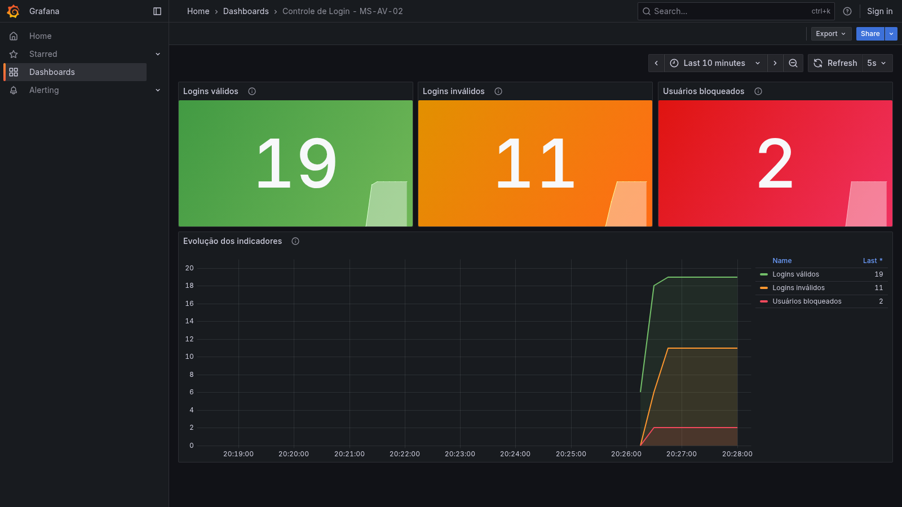

# Controle de Login — MS-AV-02 Segurança e Observabilidade

## Descrição

Projeto da atividade **MS-AV-02 - Segurança e Observabilidade** da disciplina de Microservices Development. É um mecanismo de login RESTful em Spring Boot. Ele tem bloqueio de usuários por tentativas inválidas, controle de acesso por *roles* com `JdbcUserDetailsManager`, indicadores no Prometheus, dashboard no Grafana e documentação OpenAPI/Swagger.

Enunciado: [MS-AV-02-Segurança-Observabilidade.md](MS-AV-02-Segurança-Observabilidade.md)

## Tecnologias

Java 17, Spring Boot 4, Spring Web, Spring Security, Spring Data JPA, H2, Jakarta Validation, Spring Boot Actuator, Micrometer (Prometheus), springdoc-openapi (Swagger), Prometheus, Grafana e Docker Compose.

## Como executar

1. Suba a aplicação (porta `8080`):

```bash
./mvnw spring-boot:run
```

No Windows: `mvnw.cmd spring-boot:run`

2. Suba o Prometheus e o Grafana. O dashboard e o datasource já vêm configurados:

```bash
docker compose up -d
```

3. Gere tráfego de login para alimentar os indicadores (opcional):

```bash
./scripts/gerar-trafego.sh
```

| Serviço | URL |
|---|---|
| Swagger UI | http://localhost:8080/swagger-ui/index.html |
| OpenAPI (JSON / YAML) | http://localhost:8080/v3/api-docs · http://localhost:8080/v3/api-docs.yaml |
| Métricas Prometheus | http://localhost:8080/actuator/prometheus |
| Console H2 | http://localhost:8080/h2-console (JDBC URL `jdbc:h2:mem:segurancadb`, usuário `sa`, sem senha) |
| Prometheus | http://localhost:9090 |
| Grafana | http://localhost:3000 (`admin` / `admin`), dashboard **Controle de Login - MS-AV-02** |

Para rodar os testes: `./mvnw clean verify`

## Usuários

O projeto tem dois cadastros de usuários separados:

**Operadores**: autenticação **HTTP Basic** com o `JdbcUserDetailsManager`, nas tabelas `users` / `authorities` do schema padrão do Spring Security. As senhas ficam em BCrypt.

| Usuário | Senha | Role | Pode acessar |
|---|---|---|---|
| `manutencao` | `manutencao` | `ROLE_MANUTENCAO` | `POST /` e `GET /` |
| `admin` | `admin` | `ROLE_ADMIN` | `PUT /unlock/{userid}` |

**Usuários do sistema**: ficam na tabela `usuarios` do enunciado e são validados pelo `POST /login`. Os usuários iniciais são `joao` / `123` e `maria` / `456`.

> A coluna `senha VARCHAR(10)` definida no enunciado não comporta um hash, por isso as senhas da tabela `usuarios` ficam em texto puro.

## Endpoints

| Método | Endpoint | Acesso | Respostas |
|---|---|---|---|
| POST | `/login` | público | `200` usuário e senha válidos · `401` inválidos ou usuário bloqueado |
| PUT | `/trocarsenha/{userid}` | público | `200` senha alterada · `400` nova senha inválida · `401` senha atual inválida ou usuário bloqueado · `404` usuário inexistente |
| POST | `/` | `ROLE_MANUTENCAO` | `201` cadastrado · `400` dados inválidos · `409` já cadastrado |
| PUT | `/unlock/{userid}` | `ROLE_ADMIN` | `200` desbloqueado · `404` usuário inexistente |
| GET | `/` | `ROLE_MANUTENCAO` | `200` lista de usuários (`username`, `locked`, `failedAttempts`, sem a senha) |

Nos endpoints protegidos, a requisição sem credenciais retorna `401` e o operador sem a *role* necessária recebe `403`.

Corpos JSON:

- `POST /login` e `POST /`: `{"username": "joao", "senha": "123"}`
- `PUT /trocarsenha/{userid}`: `{"atual": "123", "nova": "nova123"}`

Exemplos:

```bash
curl -i -X POST localhost:8080/login -H 'Content-Type: application/json' -d '{"username":"joao","senha":"123"}'
curl -i -X PUT localhost:8080/trocarsenha/joao -H 'Content-Type: application/json' -d '{"atual":"123","nova":"abc"}'
curl -i -u manutencao:manutencao -X POST localhost:8080/ -H 'Content-Type: application/json' -d '{"username":"pedro","senha":"789"}'
curl -i -u manutencao:manutencao localhost:8080/
curl -i -u admin:admin -X PUT localhost:8080/unlock/joao
```

## Regras de bloqueio

O controle usa a tabela `login_attempts` do enunciado:

- cada senha errada incrementa `failed_attempts` e registra `last_failed_at`;
- na **3ª falha consecutiva** o usuário recebe `locked = true` e `locked_at`. A partir daí o login retorna `401` mesmo com a senha correta;
- um login válido zera `failed_attempts`;
- `PUT /unlock/{userid}` zera as tentativas e remove o bloqueio;
- login com usuário inexistente conta como login inválido, mas não cria registro em `login_attempts`;
- errar a senha atual no `/trocarsenha` não conta como tentativa de login.

## Indicadores e dashboard

As métricas são criadas com Micrometer em `LoginMetrica` e expostas em `/actuator/prometheus`:

| Métrica (Prometheus) | Tipo | Descrição |
|---|---|---|
| `login_validos_total` | Counter | quantidade de logins válidos |
| `login_invalidos_total` | Counter | quantidade de logins inválidos |
| `usuarios_bloqueados` | Gauge | total de usuários bloqueados, lido da tabela `login_attempts` |

O Prometheus coleta as métricas da aplicação a cada 5 segundos (`prometheus/prometheus.yml`). O Grafana já sobe com o datasource (`grafana/provisioning`) e com o dashboard exportado (`grafana/dashboards/login-dashboard.json`). Se quiser importar manualmente em outro Grafana, use *Dashboards → New → Import* com esse JSON.



## Banco

O banco é H2 em memória. O schema é criado por `src/main/resources/schema.sql`: as tabelas `users` / `authorities` do `JdbcUserDetailsManager` e as tabelas `login_attempts` / `usuarios` do enunciado. No script do enunciado foi removida apenas a vírgula sobrando depois de `updated_at`, que impedia a criação da tabela. Os dados iniciais ficam em `src/main/resources/data.sql`. Os dados criados durante o uso são perdidos ao encerrar a aplicação, e os contadores do Prometheus também recomeçam do zero.

## Estrutura

- `UsuarioController`: endpoints e documentação OpenAPI;
- `LoginService`: regras de login, bloqueio, troca de senha, cadastro, desbloqueio e listagem;
- `LoginMetrica`: indicadores (Micrometer);
- `SecurityConfig`: regras de acesso por *role*, HTTP Basic e `JdbcUserDetailsManager`;
- `Usuario` / `LoginAttempt` e seus repositórios: tabelas `usuarios` e `login_attempts`;
- `GerenciamentoException`: tratamento de erros (`400`, `401`, `404`, `409`).
